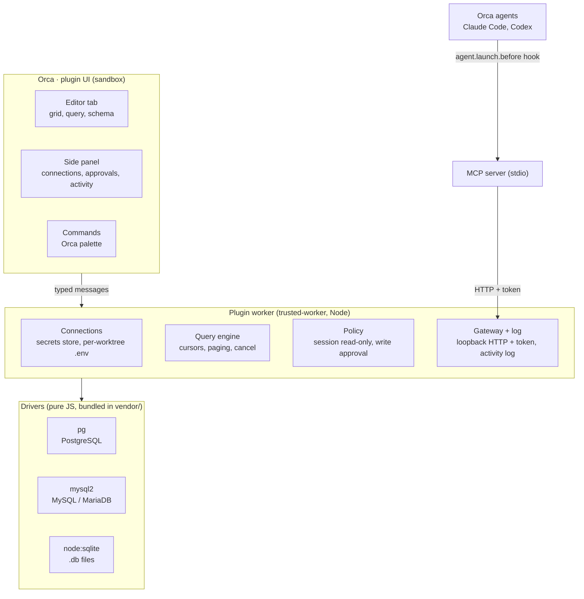

# System Architecture: DB Studio for Orca

See `PRD.md` for the product scope and requirement IDs (C1, G1, A1, ...).

## Overview

A single Orca plugin (manifest format 2). The UI runs in Orca's plugin sandbox; every database connection goes through a Node worker, which also serves Orca's agents. Neither the UI nor the agents ever talk to the database directly.



The policy layer is the single place that decides whether a query runs, whether it comes from the person or from an agent.

## Components

**UI (sandbox)**

- **Editor tab:** the main surface. Grid, SQL editor and schema page, built as an Orca custom editor. Also registered as the file editor for `.db` / `.sqlite` / `.sqlite3` / `.db3`.
- **Side panel:** connection list, pending agent-write approvals, activity log.
- **Commands:** palette entries (new query, open table, switch connection).

**Worker (Node)**

- **Connections:** registry in `storage:own`, passwords in `secrets:own`. Reads the current worktree's `.env` to offer a per-worktree connection.
- **Query engine:** runs queries through the driver interface, pages results with server-side cursors, supports cancel and timeouts.
- **Policy:** decides read-only vs read-write per origin (person / agent) and per connection; queues agent writes for approval; double-confirms human writes on `prod`.
- **Gateway + log:** loopback-only HTTP API with a fresh bearer token on every start, used by the MCP server. Every query (UI or agent) is written to the activity log.

**MCP server**

- Plain Node stdio server with no dependencies, shipped in `mcp/`.
- Tools: `list_connections`, `describe_schema`, `run_query`.
- The `agent.launch.before` hook injects the gateway URL, token and MCP config into every agent Orca launches (`--mcp-config` for Claude Code).

## Key decisions

- **Pure-JS drivers.** The Orca directory rejects native modules and binaries, and an installed plugin cannot carry `node_modules`. Bundle `pg` and `mysql2` into `vendor/` with esbuild; use Node's built-in `node:sqlite` for SQLite. Load each driver lazily.
- **Editor tab first, panel second.** The grid and SQL editor need full width; the panel only holds connections, approvals and activity.
- **One typed contract between UI and worker.** A single `protocol.ts` imported by both sides; every message is type-checked.
- **Read-only enforced by the database.** Agent sessions open with `SET TRANSACTION READ ONLY` (PostgreSQL), `START TRANSACTION READ ONLY` (MySQL), or a read-only connection (SQLite). SQL classification is only a UX hint, never the security boundary.
- **Grid paging on the server.** The worker serves blocks of ~500 rows on demand; the UI virtualizes rendering. Sort and filter become `ORDER BY` / `WHERE` on the server.
- **SQL editor.** CodeMirror 6 with `@codemirror/lang-sql` dialects, bundled into `vendor/`.

## Driver interface

Every engine implements the same interface; the UI and the query engine never branch on engine type.

```ts
interface Driver {
  connect(config: ConnectionConfig, secret: string | undefined): Promise<Session>
}

interface Session {
  introspect(): Promise<SchemaTree> // schemas, tables, views, functions, indexes, triggers, sequences
  ddl(object: ObjectRef): Promise<string> // CREATE statement for the schema page
  query(sql: string, opts: QueryOptions): Promise<Cursor>
  cancel(queryId: string): Promise<void>
  beginReadOnly(): Promise<void>
  explain(sql: string, analyze: boolean): Promise<PlanNode>
  quoteIdent(name: string): string
  close(): Promise<void>
}

interface Cursor {
  columns: ColumnMeta[]
  fetch(count: number): Promise<Row[]> // empty array = done
  close(): Promise<void>
}
```

Engine notes:

- **PostgreSQL:** cursors via `DECLARE ... CURSOR` inside a transaction (or `pg-cursor`); cancel via `pg_cancel_backend`.
- **MySQL/MariaDB:** streaming rows from `mysql2`; cancel via `KILL QUERY`.
- **SQLite:** `node:sqlite` iterates rows natively; open the file read-only unless writes are allowed.

## Security model

| Concern            | Rule                                                                                             |
| ------------------ | ------------------------------------------------------------------------------------------------ |
| Credentials        | Only in `secrets:own`; never logged, never in plain storage, never in agent env vars             |
| Agent access       | Per connection: `off`, `read-only` (default), `read-write`; read-only enforced by the DB session |
| Agent writes       | Queued in the policy layer until the person approves or refuses in the panel                     |
| Gateway            | Bound to loopback only; new bearer token on every worker start                                   |
| `prod` connections | Read-only by default; human writes need a second confirmation                                    |
| Audit              | Every query logged with SQL, origin, worktree, duration, rows, outcome                           |

## Repository layout

| Path                 | Role                                                                        |
| -------------------- | --------------------------------------------------------------------------- |
| `orca-plugin.json`   | Manifest: worker, editor, panel, commands, hook, settings                   |
| `src/protocol.ts`    | Typed UI ↔ worker contract                                                  |
| `src/worker/`        | Worker entry, connections, query engine, policy, gateway, log               |
| `src/drivers/`       | `postgres.ts`, `mysql.ts`, `sqlite.ts` + shared interface and lazy registry |
| `src/editor/`        | Grid, SQL editor, schema page                                               |
| `src/panel/`         | Connections, approvals, activity                                            |
| `mcp/`               | Dependency-free stdio MCP server                                            |
| `build/` → `vendor/` | Driver bundles and license notices                                          |
| `test/`              | Driver tests against real databases + UI tests                              |

## Testing

- **Drivers:** integration tests against real PostgreSQL, MySQL and MariaDB containers (Testcontainers) plus SQLite files, in CI.
- **Policy:** dedicated bypass tests (writes hidden in CTEs, functions, multi-statement batches) must fail in read-only mode.
- **UI:** `orca plugin test` for components, `orca plugin check` for render scenarios, `orca plugin shot` for screenshots.
- **Manifest:** `orca plugin validate .` in CI.

## Dev loop

```
orca plugin validate .      # manifest and entries
orca plugin dev watch .     # load as dev plugin, reload on save
orca plugin types .         # generate .orca/types
orca plugin test .          # *.test.ts(x) with orca/testing
orca plugin check .         # render check scenarios
orca plugin shot <key>      # PNG screenshot
```

## Open technical questions

- Can one plugin register both a file editor (`.db`) and a non-file editor (table / query tab)?
- Does `agent.launch.before` expose the agent's worktree path, so the right per-worktree connection is injected?
- Bundle size limits for `vendor/` in the directory checks.
